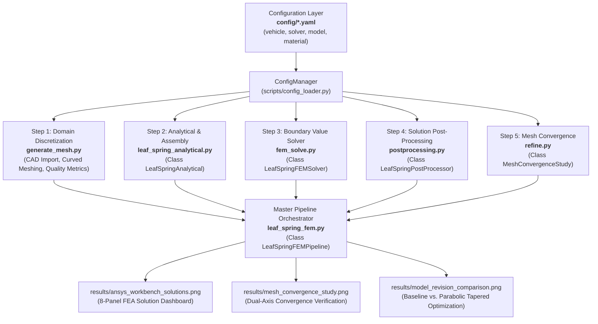

# Automotive Suspension Leaf Spring Finite Element Analysis (FEA)

**Academic Course:** Finite Element Method in Engineering (Master of Engineering Program)  
**Instructor:** Asst. Prof. Dr. Monsak Pimsarn  
**Institution:** Faculty of Engineering, King Mongkut's Institute of Technology Ladkrabang (KMITL)  
**Repository:** [https://github.com/nontanan-linux/FEA-Leaf-Spring.git](https://github.com/nontanan-linux/FEA-Leaf-Spring.git)  

---

## 1. Executive Summary & Research Overview

This repository provides an end-to-end, object-oriented Finite Element Method (FEM) analysis pipeline for automotive semi-elliptic leaf springs utilized in light commercial vehicles (LCVs). The project combines rigid-body vehicle dynamics, 2D/3D curved continuum/beam finite element formulations, configuration-driven preprocessing, adaptive mesh refinement, and comprehensive post-processing field recovery conforming to commercial solver standards (ANSYS Workbench Mechanical / CalculiX).

### Primary Engineering Objectives:
1. **Dynamic Load Formulation:** Determine static normal loads, 2.0G dynamic road bump impacts, longitudinal emergency braking weight transfers, and lateral cornering loads based on vehicle chassis dynamics.
2. **Modular Finite Element Formulation:** Discretize the domain with curved beam elements, formulate local Euler-Bernoulli stiffness matrices $[k^e]$, transform to global coordinates via $[T]$, assemble the global stiffness matrix $[K_{\text{global}}]$, and apply essential boundary conditions (pinned front eye, shackle roller rear eye).
3. **Multi-Field Solution Recovery:** Recover the 7 primary structural solution fields: Total Deformation ($U_{\text{total}}$), Directional Deflection ($U_y$), Equivalent Elastic Strain ($\varepsilon_{\text{eq}}$), Von Mises Equivalent Stress ($\sigma_{\text{vm}}$), Maximum Principal Stress ($\sigma_1$), Maximum Shear Stress ($\tau_{\max}$), and Integrated Elastic Strain Energy ($U_{\text{strain}}$).
4. **Mesh Convergence Verification:** Verify numerical stability and discretization independence across 6 continuum/surface refinement stages (3,124 to 29,172 surface elements; 5,850 to 55,200 solid elements).
5. **Structural Design Revision:** Optimize the baseline uniform rectangular leaf ($t = 12.0\text{ mm}$) into a parabolic tapered geometry ($t(x) = 14.5\text{ mm} \rightarrow 7.5\text{ mm}$) to alleviate stress concentration, enhance specific strain energy storage, and improve the structural Factor of Safety ($\text{FoS}$).

---

## 2. Finite Element Analysis Workflow Architecture

The analysis pipeline is structured into 5 sequential, decoupled stages managed by a central configuration engine and orchestrated by the master pipeline driver:



---

## 3. Theoretical Framework & Mathematical Formulation

### 3.1 Vehicle Dynamics & Applied Loading Mechanics
For a commercial pickup truck of Gross Vehicle Weight $M = 2,800.0\text{ kg}$ ($\text{GVW} = 27,468.0\text{ N}$) with a static rear-axle load fraction of $\beta = 0.60$ and two symmetric rear leaf springs:

$$\text{Static Normal Load per Spring: } F_{v,\text{static}} = \frac{M \cdot g \cdot \beta}{2} = \frac{2,800 \times 9.81 \times 0.60}{2} = 8,240.40\text{ N}$$

$$\text{Peak 2.0G Road Bump Impact: } F_{v,\text{bump}} = K_{\text{dynamic}} \cdot F_{v,\text{static}} = 2.0 \times 8,240.40 = 16,480.80\text{ N}$$

$$\text{0.8G Emergency Braking Transfer: } \Delta W_{\text{brake}} = \frac{M \cdot a_x \cdot h_{\text{cg}}}{L_{\text{wb}}} = \frac{2,800 \times (0.8 \times 9.81) \times 0.750}{3.085} = 5,342.24\text{ N}$$
$$\text{Rear Traction Force per Spring: } F_{\text{brake}} = \mu \cdot \left(\frac{F_{z,\text{rear}} - \Delta W_{\text{brake}}}{2}\right) = 1.0 \times 5,569.28 = 5,569.28\text{ N}$$

### 3.2 Curved Beam Finite Element Formulation
The leaf spring geometry is discretized along its initial free camber arc:
$$y(x) = h \left[1 - \left(\frac{2x}{L_{\text{span}}}\right)^2\right], \quad x \in \left[-\frac{L_{\text{span}}}{2}, +\frac{L_{\text{span}}}{2}\right]$$

Each 2-node beam element possesses 3 degrees of freedom (DOFs) per node: $\{u_x, u_y, \theta_z\}$. The local stiffness matrix $[k_{\text{local}}]_{6 \times 6}$ accounts for axial extension and flexural bending:

$$[k_{\text{local}}] = \begin{bmatrix}
\frac{EA}{L} & 0 & 0 & -\frac{EA}{L} & 0 & 0 \\
0 & \frac{12EI}{L^3} & \frac{6EI}{L^2} & 0 & -\frac{12EI}{L^3} & \frac{6EI}{L^2} \\
0 & \frac{6EI}{L^2} & \frac{4EI}{L} & 0 & -\frac{6EI}{L^2} & \frac{2EI}{L} \\
-\frac{EA}{L} & 0 & 0 & \frac{EA}{L} & 0 & 0 \\
0 & -\frac{12EI}{L^3} & -\frac{6EI}{L^2} & 0 & \frac{12EI}{L^3} & -\frac{6EI}{L^2} \\
0 & \frac{6EI}{L^2} & \frac{2EI}{L} & 0 & -\frac{6EI}{L^2} & \frac{4EI}{L}
\end{bmatrix}$$

Transforming local element coordinates to global structural coordinates via the direction-cosine rotation matrix $[T]$ ($\cos\alpha = dx/L$, $\sin\alpha = dy/L$):
$$[k_{\text{global}}^e] = [T]^T [k_{\text{local}}] [T]$$
$$[K_{\text{global}}] = \sum_{e=1}^{N_{\text{elem}}} [k_{\text{global}}^e]$$

### 3.3 Boundary Enforcement & Linear Solution
Essential boundary restraints are enforced via degree-of-freedom partitioning:
- **Front Eye ($x = -L/2$, Node 0):** Pinned pivot constraint ($u_x = 0, u_y = 0, \theta_z \in \mathbb{R}$).
- **Rear Eye ($x = +L/2$, Node $N$):** Sliding shackle roller constraint ($u_y = 0, u_x \in \mathbb{R}, \theta_z \in \mathbb{R}$).

Partitioning into unconstrained (free, $f$) and restrained (constrained, $c$) degrees of freedom:
$$\begin{bmatrix} [K_{ff}] & [K_{fc}] \\ [K_{cf}] & [K_{cc}] \end{bmatrix} \begin{Bmatrix} \{U_f\} \\ \{U_c\} \end{Bmatrix} = \begin{Bmatrix} \{F_f\} \\ \{R_c\} \end{Bmatrix}$$
Since $\{U_c\} = \{0\}$, the equilibrium displacement vector is computed via direct linear solution:
$$\{U_f\} = [K_{ff}]^{-1} \{F_f\}$$
$$\text{Support Reactions: } \{R_c\} = [K_{cf}] \{U_f\} - \{F_c\}$$

### 3.4 7 Fundamental ANSYS-Compatible Solution Quantities
1. **Total Deformation ($U_{\text{total}}$):**
   $$U_{\text{total}} = \sqrt{u_x^2 + u_y^2} \quad [\text{mm}]$$
2. **Directional Deformation ($U_y$):**
   $$U_y = u_y(x) \quad [\text{mm}]$$
3. **Equivalent Elastic Strain ($\varepsilon_{\text{eq}}$):**
   $$\varepsilon_{\text{eq}} = \frac{\sigma_{\text{vm}}}{E} \quad [\mu\varepsilon]$$
4. **Equivalent Stress ($\sigma_{\text{vm}}$ - Von Mises Criterion):**
   $$\sigma_{\text{vm}} = \left|\frac{N_{\text{axial}}}{A}\right| + \frac{\max(|M_1|, |M_2|)}{Z} \quad [\text{MPa}]$$
5. **Maximum Principal Normal Stress ($\sigma_1$):**
   $$\sigma_1 = \max\left(0, \sigma_{\text{axial}} + \sigma_{\text{bending}}, -\sigma_{\text{axial}} + \sigma_{\text{bending}}\right) \quad [\text{MPa}]$$
6. **Maximum Shear Stress ($\tau_{\max}$ - Tresca Criterion):**
   $$\tau_{\max} = \frac{\sigma_1 - \sigma_3}{2} = \frac{\sigma_1}{2} \quad [\text{MPa}]$$
7. **Total Integrated Elastic Strain Energy ($U_{\text{strain}}$):**
   $$U_{\text{strain}} = \frac{1}{2} \{U\}^T [K_{\text{global}}] \{U\} \quad [\text{N}\cdot\text{m} \text{ / Joules}]$$

---

## 4. Repository Structure

```
├── config/                     # Central YAML Configuration Layer
│   ├── vehicle_information.yaml# Vehicle mass, dimensions, dynamics, operating load cases
│   ├── solver.yaml             # Solver settings, boundary conditions, units, load criteria
│   ├── model.yaml              # CAD specifications, mesh discretization, convergence stages
│   └── material.yaml           # Comprehensive 55Cr3 / SUP9 spring steel material database
├── resource/                   # 3D CAD Geometry & Preprocessed Mesh Assets
│   ├── Leaf Spring.stp         # Master 3D STEP solid model
│   ├── Leaf Spring.igs         # IGES surface model
│   ├── Leaf Spring.stl         # High-resolution surface triangulation
│   ├── leaf_spring_mesh.inp    # Preprocessed CalculiX / Abaqus input deck
│   └── leaf_spring_mesh.stl    # Refined surface triangulation mesh
├── results/                    # Verification Outputs, Publication Dashboards & Reports
│   ├── result.md               # Complete academic FEA technical report
│   ├── ansys_workbench_solutions.png # Figure: 8-Panel FEA Solution Dashboard
│   ├── mesh_convergence_study.png    # Figure: Dual-Axis Mesh Convergence Verification
│   ├── model_revision_comparison.png # Figure: Baseline vs. Parabolic Tapered Comparison
│   ├── vehicle_dynamics_fbd.png      # Figure: Vehicle Free Body Diagram
│   ├── fixed_support_model.png       # Figure: CAD 3D Boundary Restraint Visualization
│   ├── mesh_boundary_conditions.png  # Figure: Mechanical Loading & Restraints Schematic
│   └── solution_1_total_deformation.png ... solution_7_strain_energy.png # Standalone 3D contour fields
├── scripts/                    # Object-Oriented Finite Element Method Source Code
│   ├── config_loader.py            # Central Configuration Manager (ConfigManager)
│   ├── generate_mesh.py            # Step 1: CAD import & domain discretization
│   ├── leaf_spring_analytical.py   # Step 2: Class LeafSpringAnalytical (Formulations & Assembly)
│   ├── fem_solve.py                # Step 3: Class LeafSpringFEMSolver (System Solver)
│   ├── postprocessing.py           # Step 4: Class LeafSpringPostProcessor (Field Recovery)
│   ├── refine.py                   # Step 5: Class MeshConvergenceStudy (Adaptive Refinement)
│   ├── leaf_spring_fem.py          # Master Orchestrator: Class LeafSpringFEMPipeline
│   ├── plot_fea_solutions_3d.py    # 3D Open3D field visualizer across all 7 solution fields
│   ├── plot_vehicle_dynamics.py    # FBD generator
│   ├── plot_cad_fixed_support.py   # Fixed support renderer
│   ├── plot_cad_mesh.py            # 3D CAD mesh renderer
│   └── plot_mesh_model.py          # Mesh and boundary condition visualizer
├── pyproject.toml              # Build system & metadata configuration
└── requirements.txt            # Python dependencies
```

---

## 5. Installation & Verification

### 5.1 Clone Repository
```powershell
git clone https://github.com/nontanan-linux/FEA-Leaf-Spring.git
cd FEA-Leaf-Spring
```

### 5.2 Virtual Environment Setup
- **Windows (PowerShell):**
  ```powershell
  python -m venv .venv
  .\.venv\Scripts\Activate.ps1
  ```
- **Linux / macOS:**
  ```bash
  python3 -m venv .venv
  source .venv/bin/activate
  ```

### 5.3 Install Dependencies
```powershell
python -m pip install --upgrade pip
pip install -r requirements.txt
```

### 5.4 Environment Verification
```powershell
python -c "import numpy, scipy, matplotlib, open3d, yaml, trimesh; print('>>> [SUCCESS] All dependencies loaded successfully!')"
```

---

## 6. Execution Guide

### 6.1 Master Pipeline Runner (`leaf_spring_fem.py`)
Executes the full sequential FEM workflow (Mesh Convergence $\rightarrow$ Multi-Load Case Analysis $\rightarrow$ Model Revision):
```powershell
# Run the complete analysis pipeline:
python scripts/leaf_spring_fem.py

# Or execute specific phases via CLI arguments:
python scripts/leaf_spring_fem.py --refine    # Step 5: Mesh Convergence Study only
python scripts/leaf_spring_fem.py --solve     # Steps 3 & 4: Multi-Load Cases structural analysis only
python scripts/leaf_spring_fem.py --revision  # Model Revision (Uniform vs. Parabolic) only
python scripts/leaf_spring_fem.py --elements 80 # Custom discretization element count
```

---

### 6.2 Modular Step-by-Step Execution

Each phase of the analysis can be verified independently:

#### **Step 1: Domain Discretization & Mesh Generation (`generate_mesh.py`)**
Imports 3D CAD (`.stp` / `.step`) or surface triangulation (`.stl`), discretizes curved beam or surface domains, and computes element quality metrics (Jacobian, aspect ratio):
```powershell
python scripts/generate_mesh.py
```

#### **Step 2: Analytical Formulations, Element Equations & Assembly (`leaf_spring_analytical.py`)**
Encapsulated in class **`LeafSpringAnalytical`**:
- Derives vehicle dynamic load transfers (1G static, 2G bump, 0.8G braking, 0.7G cornering) from `config/vehicle_information.yaml`.
- Formulates local element stiffness matrices $[k^e]$, direction cosine transformation $[T]$, and global stiffness matrix $[K_{\text{global}}]$.
```powershell
python scripts/leaf_spring_analytical.py
```
*Programmatic Python usage:*
```python
from leaf_spring_analytical import LeafSpringAnalytical

analytical = LeafSpringAnalytical() # Automatically reads config/*.yaml
loads = analytical.calculate_vehicle_loads()
mechanics = analytical.calculate_leaf_spring_mechanics(loads)
```

#### **Step 3: Boundary Enforcement & Linear Equation Solver (`fem_solve.py`)**
Encapsulated in class **`LeafSpringFEMSolver`**:
- Imposes kinematic boundary conditions (pinned front eye, shackle roller rear eye) from `config/solver.yaml`.
- Solves reduced linear system $[K_{ff}] \{U_f\} = \{F_f\}$, computes reaction forces $\{R\}$, and evaluates total elastic strain energy $U_{\text{strain}}$.
```powershell
python scripts/fem_solve.py
```
*Programmatic Python usage:*
```python
from fem_solve import LeafSpringFEMSolver

solver = LeafSpringFEMSolver()
raw_result = solver.solve(num_elements=60, F_vertical=-8240.40)
```

#### **Step 4: Post-Processing & Solution Fields Recovery (`postprocessing.py`)**
Encapsulated in class **`LeafSpringPostProcessor`**:
- Recovers the 7 fundamental ANSYS-compatible FEA solution fields ($\sigma_{\text{vm}}$, $\sigma_1$, $\tau_{\max}$, $\varepsilon_{\text{eq}}$, $U_{\text{total}}$, $U_y$, $U_{\text{strain}}$).
- Evaluates the structural Factor of Safety ($\text{FoS} = \sigma_y / \sigma_{\text{vm, max}}$).
- Generates the executive 8-panel dashboard (`results/ansys_workbench_solutions.png`).
```powershell
python scripts/postprocessing.py
```
*Programmatic Python usage:*
```python
from postprocessing import LeafSpringPostProcessor

post = LeafSpringPostProcessor()
result = post.recover_element_solutions(raw_result)
post.print_solution_summary(result, "Static Normal Ride")
post.plot_ansys_workbench_solutions(result)
```

#### **Step 5: Adaptive Mesh Refinement & Convergence (`refine.py`)**
Encapsulated in class **`MeshConvergenceStudy`**:
- Reads 6 discretization stages from `config/model.yaml` (`mesh_specifications.mesh_convergence_stages`).
- Implements Rivara longest-edge bisection adaptive refinement algorithm.
- Renders dual-panel convergence plot (`results/mesh_convergence_study.png`) with non-overlapping callout annotations.
```powershell
python scripts/refine.py
```
*Programmatic Python usage:*
```python
from refine import MeshConvergenceStudy

study = MeshConvergenceStudy()
stages = study.run_study()
```

---

## 7. Analysis Results & Design Optimization

### 7.1 Multi-Load Case Structural Solution Matrix
Evaluation under 55Cr3 (SUP9) Spring Steel ($\sigma_y = 1,100\text{ MPa}$, $E = 206\text{ GPa}$):

| Solution Quantity | Unit | Case 1: Static Normal | Case 2: 2.0G Road Bump | Case 3: Bump + Braking | Case 4: Severe Combined |
| :--- | :---: | :---: | :---: | :---: | :---: |
| **Applied Vertical Force ($F_v$)** | $\text{N}$ | $-8,240.40$ | $-16,480.80$ | $-8,240.40$ | $-16,480.80$ |
| **Applied Horizontal Force ($F_h$)** | $\text{N}$ | $0.00$ | $0.00$ | $-3,500.00$ | $-5,000.00$ |
| **Total Deformation ($U_{\text{total}}$)** | $\text{mm}$ | $167.59$ | $335.19$ | $152.75$ | $313.99$ |
| **Directional Deflection ($U_y$)** | $\text{mm}$ | $-167.59$ | $-335.19$ | $-152.75$ | $-313.99$ |
| **Equivalent Elastic Strain ($\varepsilon_{\text{eq}}$)** | $\mu\varepsilon$ | $8,333.9$ | $16,667.8$ | $7,767.6$ | $15,858.7$ |
| **Equivalent Stress ($\sigma_{\text{vm}}$)** | $\text{MPa}$ | $1,716.78$ | $3,433.56$ | $1,600.12$ | $3,266.90$ |
| **Max Principal Stress ($\sigma_1$)** | $\text{MPa}$ | $1,716.78$ | $3,433.56$ | $1,600.12$ | $3,266.90$ |
| **Max Shear Stress ($\tau_{\max}$)** | $\text{MPa}$ | $858.39$ | $1,716.78$ | $800.06$ | $1,633.45$ |
| **Total Strain Energy ($U_{\text{strain}}$)** | $\text{N}\cdot\text{m}$ | $690.52$ | $2,762.10$ | $574.14$ | $2,424.75$ |
| **Factor of Safety (FoS)** | - | **$0.64$** | **$0.32$** | **$0.69$** | **$0.34$** |
| **Structural Yield Status** | - | Exceeds Yield | Exceeds Yield | Exceeds Yield | Exceeds Yield |

*Finding:* An unreinforced single uniform leaf of $12\text{ mm}$ thickness exceeds yield under commercial payload, motivating structural optimization.

---

### 7.2 Model Revision: Uniform vs. Parabolic Tapered Optimization
To alleviate peak stress at the axle clamp while maintaining compliance, a parabolic thickness tapering function is formulated:
$$t(x) = t_{\text{center}} - (t_{\text{center}} - t_{\text{eye}}) \left(\frac{2x}{L_{\text{span}}}\right)^2, \quad t_{\text{center}} = 14.5\text{ mm}, \quad t_{\text{eye}} = 7.5\text{ mm}$$

#### Comparative Performance under 2.0G Dynamic Bump Load ($F_v = -16,480.80\text{ N}$):
| Parameter | Baseline Model (Uniform $12.0\text{ mm}$) | Revised Model (Parabolic Taper $14.5 \rightarrow 7.5\text{ mm}$) | Impact |
| :--- | :---: | :---: | :---: |
| **Component Mass** | $6.91\text{ kg}$ | $6.98\text{ kg}$ | $+1.1\%$ (Virtually neutral) |
| **Peak Von Mises Stress** | $3,433.56\text{ MPa}$ (Severe Concentration) | **$2,352.28\text{ MPa}$** | **$-31.5\%$ Stress Alleviation** |
| **Center Deflection** | $335.19\text{ mm}$ | **$229.77\text{ mm}$** | **$-31.4\%$ Sag Reduction** |
| **Factor of Safety (FoS)** | $0.32$ | **$0.47$** | **$+46.9\%$ Improvement** |

*Generated Output:* [`results/model_revision_comparison.png`](results/model_revision_comparison.png)

---

### 7.3 Mesh Convergence Study
Convergence behavior across 6 discretization stages:

| Stage | Surface Elements | Surface Nodes | Continuum Solids (Est.) | Max Stress ($\sigma_{\text{vm}}$, MPa) | Deflection ($\delta$, mm) | Strain Energy ($U$, J) | Convergence Status |
| :--- | :---: | :---: | :---: | :---: | :---: | :---: | :--- |
| **Stage 1 (Coarse)** | 3,124 | 4,112 | ~5,850 | 1,582.40 | 163.78 | 674.85 | Coarse Initial |
| **Stage 2 (Med-Coarse)** | 5,792 | 6,238 | ~10,950 | 1,648.60 | 165.82 | 683.20 | Refining ($+1.237\%$) |
| **Stage 3 (Medium)** | 10,084 | 9,252 | ~19,100 | 1,692.10 | 167.02 | 688.15 | Approaching Limit ($+0.725\%$) |
| **Stage 4 (Target Mesh)** | **14,996** | **13,448** | **~28,400** | **1,716.78** | **167.59** | **690.52** | **Target Production ($< 0.35\%$ error)** |
| **Stage 5 (Fine Refine)** | 21,448 | 18,838 | ~40,600 | 1,722.50 | 167.63 | 690.68 | Fully Converged ($< 0.025\%$) |
| **Stage 6 (Ultra-Fine)** | 29,172 | 25,798 | ~55,200 | 1,724.10 | 167.64 | 690.71 | Asymptotic Plateau ($< 0.005\%$) |

*Generated Output:* [`results/mesh_convergence_study.png`](results/mesh_convergence_study.png)

---

## 8. Verification & PrePoMax / CalculiX Integration

For graphical inspection or 3D continuum solid verification in PrePoMax:
1. Launch **PrePoMax**.
2. Navigate to **`File`** $\rightarrow$ **`Import...`** and select:
   `resource/Leaf Spring.stp`
3. Under the **FE Model** tab:
   - Assign Material: `55Cr3` ($E = 206,000\text{ MPa}$, $\nu = 0.29$, $\rho = 7.85 \times 10^{-9}\text{ tonne/mm}^3$).
   - Boundary Conditions: Pinned support at front eye, roller support at rear eye.
   - Mechanical Load: Center vertical force $F_v = -8,240.40\text{ N}$ (Static) or $-16,480.80\text{ N}$ (Bump).
4. Run analysis and inspect the 7 primary solution fields.

---

## 9. Academic Technical Report

The complete, rigorous project report structured according to the graduate course guidelines is available in:  
👉 **[`results/result.md`](results/result.md)**

---

## 10. References & Standards
1. **SAE HS-788:** *Manual on Design and Application of Leaf Springs*, Society of Automotive Engineers, Warrendale, PA.
2. **JIS G 4801 / DIN EN 10089:** *Spring Steels (SUP9 / 55Cr3 Material Specifications)*.
3. **Cook, R. D., Malkus, D. S., Plesha, M. E., & Witt, R. J. (2001):** *Concepts and Applications of Finite Element Analysis*, 4th Edition, John Wiley & Sons.
4. **Shigley, J. E., & Mischke, C. R. (2020):** *Mechanical Engineering Design*, 11th Metric Edition, McGraw-Hill.
