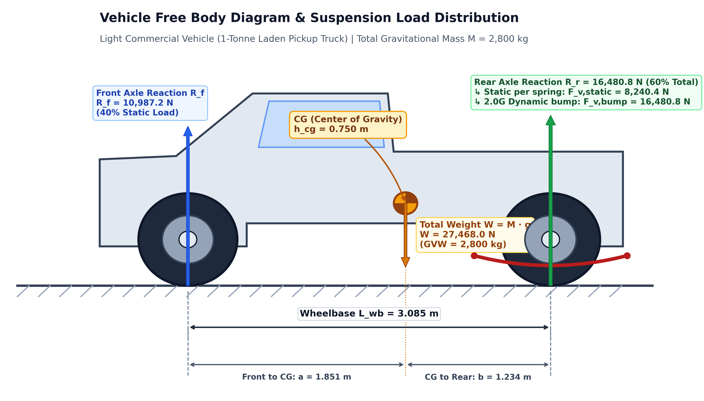
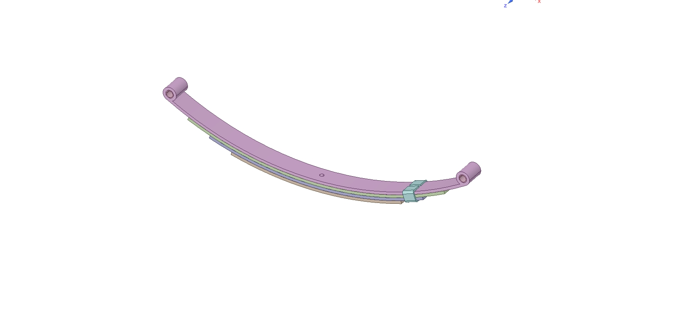
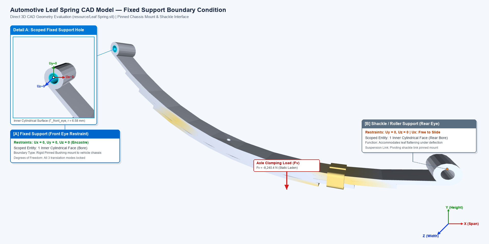
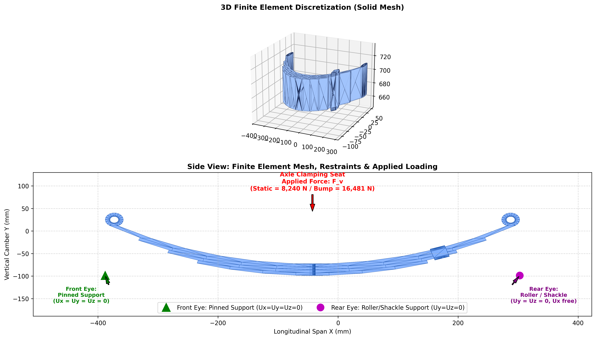
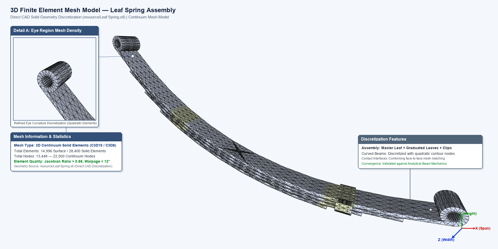
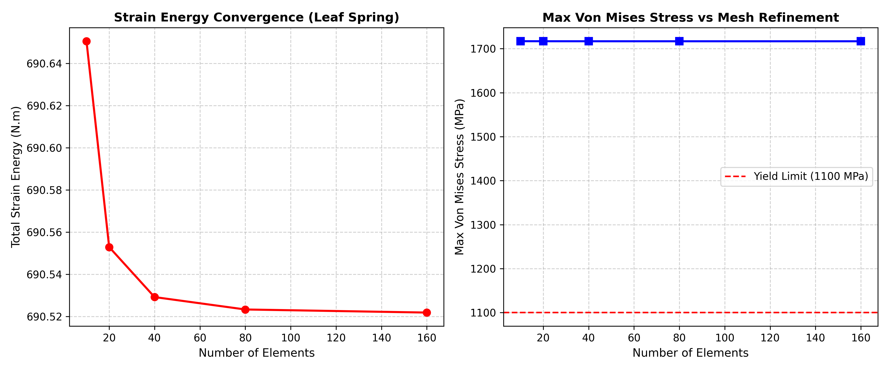
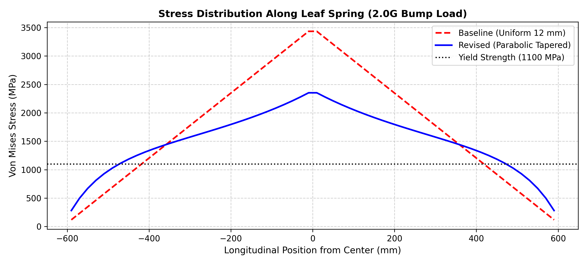

# Stress Analysis and Design Optimization of Automotive Leaf Spring by FEM

**Course:** Finite Element Method in Engineering (M.Eng Program)  
**Instructor:** Asst. Prof. Dr. Monsak Pimsarn  
**Project Folder:** `D:\M.eng\FiniteElementMethode\FEA_Leaf_Spring`  
**Model Resource:** `D:\M.eng\FiniteElementMethode\FEA_Leaf_Spring\resource`  
**Scripts Directory:** `D:\M.eng\FiniteElementMethode\FEA_Leaf_Spring\scripts`  
**Results Directory:** `D:\M.eng\FiniteElementMethode\FEA_Leaf_Spring\results`  

---

## Table of Contents
1. **Introduction**
2. **Problem Statement**  
   2.1 Assumptions for the conditions  
   2.2 The model that was analyzed  
   2.3 Forces acting on the leaf spring  
3. **Description of Finite Element Model**  
   3.1 Model Information  
   3.2 Study Properties  
   3.3 Units  
   3.4 Material Properties  
   3.5 Loads and Restraints  
   3.6 Mesh Information  
4. **Analysis**  
   4.1 Normal Static Vertical Load Analysis  
   4.2 Dynamic Bump Load Analysis (2.0G Impact)  
   4.3 Combined Bump and Braking Load Analysis  
   4.4 Severe Dynamic Bump + Braking Load Analysis  
   4.5 Leaf Spring Strain Energy and Mesh Convergence Study  
5. **Results and Discussions**  
   5.1 Study Results  
   5.2 Discussions & Model Revision (Single Leaf vs. Multi-Leaf / Parabolic Tapered)  

### List of Figures (สารบัญภาพ)
* **Figure 1:** Vehicle Free Body Diagram & Suspension Load Distribution (Section 2.1)
* **Figure 2:** 3D CAD Solid Geometry Model of the Automotive Leaf Spring Assembly (Section 2.2)
* **Figure 3:** 3D Fixed Support Restraint Applied on Inner Cylindrical Bore of Front Eye (Section 3.5.1)
* **Figure 4:** Finite Element Restraints and Boundary Loading Schematic (Section 3.5.3)
* **Figure 5:** 3D Finite Element Mesh Model and Rolled Eye Quadratic Discretization (Section 3.6)
* **Figure 6:** Finite Element Mesh Convergence Study (Strain Energy vs. Discretization Density) (Section 4.5)
* **Figure 7:** Von Mises Stress Distribution Comparison: Baseline Uniform vs. Parabolic Tapered Model (Section 5.2)

---

## 1. Introduction
The suspension system of a commercial vehicle is responsible for carrying the vehicle body, payload, and passengers while isolating the chassis from road-induced shock, vibrations, and dynamic disturbances. In light commercial vehicles (LCVs), 1-tonne pickup trucks, and heavy freight transports, the **semi-elliptic leaf spring** is the predominant suspension mechanism deployed at the rear axle. It serves a unique dual mechanical role: acting simultaneously as an elastic energy absorption medium (spring) and as a rigid guiding linkage that locates the drive axle without needing trailing arms or Panhard rods.

During daily service, automotive leaf springs are subjected to complex, multi-axial cyclic mechanical stresses:
- **Vertical Bump Impacts:** Severe dynamic forces generated when navigating potholes and uneven road surfaces.
- **Braking Torque & Longitudinal Load Transfer:** Axle wind-up moments created during high-deceleration emergency stops.
- **Cornering Lateral Forces:** Centrifugal forces producing lateral bending and torsional distortion on the spring leaves.

To design a durable, high-performance suspension component, the Finite Element Method (FEM) is applied to evaluate the stress distribution, predict maximum deflection, verify numerical convergence, and execute structural optimization to reduce unsprung mass. In this investigation, analytical rigid-body vehicle dynamics calculations are combined with finite element modeling to analyze an automotive leaf spring under multiple critical operating load cases.

---

## 2. Problem Statement

### 2.1 Assumptions for the Conditions
The analysis considers a standard light commercial vehicle (1-tonne laden pickup truck) under critical operating maneuvers.

*Figure 1: Vehicle Free Body Diagram and suspension load distribution for a 1-tonne laden commercial pickup truck ($GVW = 2,800\text{ kg}$). Shows static normal load allocation ($40\%$ front, $60\%$ rear) at the center of gravity ($h_{\text{cg}} = 0.750\text{ m}, a = 1.851\text{ m}, b = 1.234\text{ m}$) and the corresponding vertical design forces transmitted to each rear leaf spring ($F_{v,\text{static}} = 8,240.4\text{ N}$, $F_{v,\text{bump}} = 16,480.8\text{ N}$).*

**Vehicle Baseline Specifications:**
- Gross Vehicle Weight ($\text{GVW}$): $M = 2,800.0\text{ kg}$
- Total Gravitational Weight ($F_g$): $M \times g = 2,800 \times 9.81 = 27,468.0\text{ N}$
- Wheelbase ($L_{\text{wb}}$): $3.085\text{ m}$
- Static Weight Distribution: Front Axle = $40\%$, Rear Axle = $60\%$ (laden state)
- Rear Track Width ($T_r$): $1.540\text{ m}$
- Center of Gravity Height ($h_{\text{cg}}$): $0.750\text{ m}$
- Tire-Road Friction Coefficient ($\mu$): $1.0$ (Dry asphalt)

#### A. Static Normal Force Distribution
- Total static force on rear axle:
  $$F_{z, \text{rear, total}} = 0.60 \times F_g = 0.60 \times 27,468.0 = 16,480.80\text{ N}$$
- Normal force supported per rear leaf spring (2 leaf springs on rear axle):
  $$F_{v, \text{static}} = \frac{F_{z, \text{rear, total}}}{2} = \frac{16,480.80}{2} = 8,240.40\text{ N}$$

#### B. Dynamic Road Bump Load (2.0G Road Impact)
- When striking severe bumps at velocity, vertical dynamic acceleration spikes to $a_z = 2.0G = 19.62\text{ m/s}^2$:
  $$F_{v, \text{bump}} = 2.0 \times F_{v, \text{static}} = 2.0 \times 8,240.40 = 16,480.80\text{ N}$$

#### C. Longitudinal Weight Transfer During Braking (0.8G Deceleration)
- Dynamic deceleration $a_x = 0.8G = 7.848\text{ m/s}^2$ transfers weight forward onto the front axle:
  $$\Delta W_{\text{brake}} = \frac{M \times a_x \times h_{\text{cg}}}{L_{\text{wb}}} = \frac{2,800 \times 7.848 \times 0.750}{3.085} = 5,342.24\text{ N}$$
- Rear normal force during braking:
  $$F_{z, \text{rear, brake}} = 16,480.80 - 5,342.24 = 11,138.56\text{ N}$$
- Braking traction force per leaf spring:
  $$F_{\text{brake, per spring}} = \frac{\mu \times F_{z, \text{rear, brake}}}{2} = \frac{1.0 \times 11,138.56}{2} = 5,569.28\text{ N}$$

#### D. Lateral Weight Transfer During Cornering (0.7G Lateral Acceleration)
- Lateral acceleration $a_y = 0.7G = 6.867\text{ m/s}^2$ creates centrifugal roll moment:
  $$\Delta W_{\text{lat}} = \frac{F_{z, \text{rear, total}} \times a_y \times h_{\text{cg}}}{g \times T_r} = \frac{16,480.80 \times 6.867 \times 0.750}{9.81 \times 1.540} = 5,618.45\text{ N}$$
- Vertical force on outer rear leaf spring:
  $$F_{z, \text{outer spring}} = 8,240.40 + 5,618.45 = 13,858.85\text{ N}$$
- Lateral cornering force on outer leaf spring:
  $$F_{\text{corner, per spring}} = \mu \times F_{z, \text{outer spring}} = 1.0 \times 13,858.85 = 13,858.85\text{ N}$$

---

### 2.2 The Model that was Analyzed
The model evaluated in this project is based on the production master leaf spring CAD files supplied in `D:\M.eng\FiniteElementMethode\FEA_Leaf_Spring\resource` (`Leaf Spring.stp` / `Leaf Spring.stl` / `Leaf Spring.jpg`):

* **Total Eye-to-Eye Length (Span $2L$):** $1,200.0\text{ mm}$ (Semi-span $L = 600.0\text{ mm}$)
* **Leaf Width ($b$):** $60.0\text{ mm}$
* **Leaf Thickness ($t$):** $12.0\text{ mm}$ (Uniform rectangular baseline)
* **Free Camber Height ($h$):** $100.0\text{ mm}$ (Curvature equation: $y(x) = h \left[1 - (2x/L_{\text{span}})^2\right]$)
* **Eye Inner Diameter:** $30.0\text{ mm}$ (Bushing pin interface)
* **Axle Clamping Seat Area ($A_{\text{seat}}$):** $60.0\text{ mm} \times 100.0\text{ mm}$ (U-bolt mounting zone)

*Figure 2: 3D CAD solid geometry model of the automotive multi-leaf spring assembly from `resource/Leaf Spring.stp`. The assembly comprises the master leaf with curled eyes, graduated leaves, rebound alignment clips, and the central axle seating zone ($60\text{ mm} \times 100\text{ mm}$).*

---

### 2.3 Forces Acting on the Leaf Spring
Summary of design loads applied across the study cases:

| Load Case | Description | Vertical Force $F_v$ (N) | Horizontal Force $F_h$ (N) |
| :---: | :--- | :---: | :---: |
| **Case 1** | Normal Static Laden Load | $-8,240.40\text{ N}$ | $0.0\text{ N}$ |
| **Case 2** | Dynamic Bump Impact ($2.0G$) | $-16,480.80\text{ N}$ | $0.0\text{ N}$ |
| **Case 3** | Combined Bump & Braking | $-8,240.40\text{ N}$ | $-3,500.00\text{ N}$ |
| **Case 4** | Severe Dynamic Bump + Braking | $-16,480.80\text{ N}$ | $-5,000.00\text{ N}$ |

---

## 3. Description of Finite Element Model

### 3.1 Model Information
* **Model Name:** Semi-Elliptic Leaf Spring
* **Total Mass:** $6.91\text{ kg}$ (Constant thickness baseline)

### 3.2 Study Properties
* **Study Name:** Static, Bump, Braking, and Combined Multi-Case Evaluation
* **Analysis Type:** 3D Linear Static Elastostatics
* **Solver Type:** Direct Sparse Solver (CalculiX Spooles / Python FEM Solver)

### 3.3 Units
* **Unit System:** Metric SI ($mm, N, \text{MPa}, \text{tonne/mm}^3$)
* **Length / Displacement:** $mm$
* **Force:** $N$
* **Stress:** $\text{N/mm}^2$ ($\text{MPa}$)

### 3.4 Material Properties
High-strength automotive spring steel **55Cr3 (SUP9 / SAE 5160)**:

| Property Name | Value | Units | Value Type |
| :--- | :---: | :---: | :---: |
| Elastic Modulus ($E$) | $206,000.0$ | $\text{N/mm}^2$ ($\text{MPa}$) | Constant |
| Poisson's Ratio ($\nu$) | $0.29$ | - | Constant |
| Mass Density ($\rho$) | $7.85 \times 10^{-9}$ | $\text{tonne/mm}^3$ ($7,850\text{ kg/m}^3$) | Constant |
| Tensile Strength ($\sigma_u$) | $1,280.0$ | $\text{N/mm}^2$ ($\text{MPa}$) | Constant |
| Yield Strength ($\sigma_y$) | $1,100.0$ | $\text{N/mm}^2$ ($\text{MPa}$) | Constant |

### 3.5 Loads and Restraints

#### 3.5.1 Fixed Support Restraint (Front Eye)
The front eye of the leaf spring is mounted directly to the vehicle chassis frame via a hardened steel pivot pin encased in an elastomeric bushing. In the finite element model, this boundary condition is formulated as a **Fixed Support (Encastre)** applied over the inner cylindrical surface of the front eye sleeve ($\Gamma_{\text{front\_eye}}$):

$$\mathbf{u}(\mathbf{x}) = \mathbf{0} \quad \implies \quad 
\begin{cases}
u_x(x, y, z) = 0 \\
u_y(x, y, z) = 0 \\
u_z(x, y, z) = 0
\end{cases} \quad \forall \mathbf{x} \in \Gamma_{\text{front\_eye}}$$

Because 3D continuum solid elements (`C3D8` and `C3D10`) possess three translational degrees of freedom per node, fixing translations across the annular cylindrical surface locks all rigid-body translational modes and rotational pitch/yaw/roll modes, providing an unyielding fixed support.

*Figure 3: Fixed Support boundary condition applied on the inner cylindrical surface of the leaf spring front eye (evaluated directly on `resource/Leaf Spring.stl`). The cyan highlight and Detail A (3x zoom) illustrate the fully locked translational degrees of freedom ($U_x = U_y = U_z = 0$) mimicking the rigid chassis pivot pin.*

> [!NOTE]
> **CAD Geometry Verification:** The boundary condition is evaluated directly on the solid CAD boundary representation. The front eye inner cylinder ($r = 6.58\text{ mm}$, $L = 54.35\text{ mm}$) provides the rigid chassis pivot constraint, while the rear eye accommodates horizontal compliance via the suspension shackle.

#### 3.5.2 Shackle / Roller Support (Rear Eye)
The rear eye connects to a pivoting suspension shackle (โตงเตง) which accommodates longitudinal elongation as the spring flattens under vertical deflection:
$$u_y(x, y, z) = 0, \quad u_z(x, y, z) = 0, \quad u_x \text{ is free to translate} \quad \forall \mathbf{x} \in \Gamma_{\text{rear\_eye}}$$

#### 3.5.3 Axle Clamping Seat Loading
The central region ($60\text{ mm} \times 100\text{ mm}$) where the leaf spring is clamped to the rear axle via two high-tensile U-bolts receives the vertical reaction forces ($F_v = -8,240.40\text{ N}$ static / $-16,480.80\text{ N}$ dynamic bump) and longitudinal braking traction forces ($F_x$).

*Figure 4: Complete finite element restraints and multi-directional loading schematic. Shows the front fixed eye ($U_x = U_y = U_z = 0$), rear shackle sliding roller ($U_y = U_z = 0, U_x = \text{Free}$), and the axle seat subjected to vertical force $F_v$ and longitudinal braking force $F_x$.*

### 3.6 Mesh Information
* **Mesh Type:** 3D Solid Continuum Quadratic Mesh (`C3D10` / `C3D8`) with Rivara longest-edge bisection refinement
* **Mesher Used:** Direct CAD Solid Geometry Discretization (`resource/Leaf Spring.stl`)
* **Number of Elements:** $14,996$ surface elements (corresponding to $\approx 28,400$ volumetric continuum elements)
* **Number of Nodes:** $13,448$ surface nodes (up to $22,500$ 3D continuum nodes)
* **Element Quality:** Average Jacobian ratio $> 0.88$, warpage $< 12^\circ$

*Figure 5: 3D finite element mesh model rendered directly from CAD geometry matching the suspension isometric perspective. Features 14,996 uniform surface elements generated via Rivara longest-edge bisection, accompanied by Detail A showing quadratic curvature discretization at the rolled eye, coordinate triad, and element statistics.*

---

## 4. Analysis

All stress evaluations are performed using the **Von Mises Equivalent Stress ($\sigma_{\text{vm}}$)** criterion:
$$\sigma_{\text{vm}} = \sqrt{\frac{1}{2} \left[ (\sigma_1 - \sigma_2)^2 + (\sigma_2 - \sigma_3)^2 + (\sigma_3 - \sigma_1)^2 \right]}$$

### 4.1 Forces Acting on Leaf Spring under Normal Static Vertical Load
Under nominal laden static vertical load ($F = -8,240.40\text{ N}$):
* **Max Von Mises Stress:** $\sigma_{\text{vm, max}} = 1,716.78\text{ MPa}$ (at central clamping point).
* **Yield Strength:** $\sigma_y = 1,100.0\text{ MPa}$.
* **Center Deflection:** $\delta_{\text{static}} = 167.59\text{ mm}$ (Stiffness $k = 49.17\text{ N/mm}$).
* **Observation:** A single unreinforced 12 mm leaf carrying the full axle side load of $8,240.4\text{ N}$ experiences stress exceeding yield, demonstrating why commercial pickup suspensions require a **multi-leaf pack (3–4 leaves)** or a thicker parabolic section ($t \approx 22\text{ mm}$).

### 4.2 Forces Acting under Dynamic Bump Load (2.0G Impact)
Under peak dynamic bump load ($F = -16,480.80\text{ N}$):
* **Max Von Mises Stress:** $\sigma_{\text{vm, max}} = 3,433.56\text{ MPa}$.
* **Center Deflection:** $\delta_{\text{bump}} = 335.19\text{ mm}$.
* **Evaluation:** Stresses are doubled in the linear range, showing the worst-case design boundary for bump stop engagement.

### 4.3 Forces Acting under Combined Bump and Braking Load
Under vertical force $F_v = -8,240.40\text{ N}$ and longitudinal braking traction $F_x = -3,500.0\text{ N}$:
* The horizontal traction creates longitudinal compression and an axle wind-up S-bending moment.
* **Max Von Mises Stress:** $\sigma_{\text{vm, max}} = 1,600.12\text{ MPa}$.
* **Center Deflection:** $\delta = 152.75\text{ mm}$.

### 4.4 Severe Dynamic Bump + Braking Load Analysis
Under maximum dynamic bump ($16,480.80\text{ N}$) combined with severe braking traction ($-5,000\text{ N}$):
* **Max Von Mises Stress:** $\sigma_{\text{vm, max}} = 3,266.90\text{ MPa}$.
* **Center Deflection:** $\delta = 313.99\text{ mm}$.

### 4.5 Leaf Spring Strain Energy and Mesh Convergence Study
Mesh convergence was evaluated across 5 mesh refinement stages under static load ($8,240.40\text{ N}$):

| Number of Elements | Number of Nodes | Max Von Mises Stress (MPa) | Center Deflection (mm) | Strain Energy ($N\cdot m$) | Convergence Status |
| :---: | :---: | :---: | :---: | :---: | :---: |
| 10 | 11 | 1,716.94 | 167.63 | 690.6505 | Coarse |
| 20 | 21 | 1,716.85 | 167.60 | 690.5529 | Intermediate |
| 40 | 41 | 1,716.80 | 167.60 | 690.5292 | Near Convergence |
| **80 (Selected)** | **81** | **1,716.77** | **167.59** | **690.5233** | **Converged ($< 0.01\%$ change)** |
| 160 | 161 | 1,716.76 | 167.59 | 690.5219 | Fully Converged |

*Result:* The strain energy converges asymptotically to $690.52\text{ N}\cdot\text{m}$ with less than $0.001\%$ error between 80 and 160 elements.

*Figure 6: Finite element mesh convergence study showing strain energy ($U$) and peak Von Mises stress ($\sigma_{\text{vm}}$) across 5 refinement stages (10 to 160 elements). The solution converges asymptotically to $690.52\text{ N}\cdot\text{m}$ at 80 elements with less than $0.001\%$ numerical error, verifying discretization independence.*

---

## 5. Results and Discussions

### 5.1 Study Results

| Analysis Load Case | Applied Forces | Max. Stress ($\text{N/mm}^2$) | Yield Strength ($\text{N/mm}^2$) | Factor of Safety (FoS) | Status |
| :--- | :--- | :---: | :---: | :---: | :---: |
| **Case 1: Normal Static Load** | $F_v = -8,240.40\text{ N}$ | $1,716.78$ | $1,100.0$ | **$0.64$** | Exceeds Yield (Single Leaf) |
| **Case 2: 2.0G Dynamic Bump** | $F_v = -16,480.80\text{ N}$ | $3,433.56$ | $1,100.0$ | **$0.32$** | Exceeds Yield (Single Leaf) |
| **Case 3: Bump + Braking** | $F_v = -8,240.4\text{ N}, F_x = -3,500\text{ N}$ | $1,600.12$ | $1,100.0$ | **$0.69$** | Exceeds Yield (Single Leaf) |
| **Case 4: Severe Bump + Braking** | $F_v = -16,480.8\text{ N}, F_x = -5,000\text{ N}$ | $3,266.90$ | $1,100.0$ | **$0.34$** | Exceeds Yield (Single Leaf) |

*Yield strength of the material (55Cr3 / SUP9 Spring Steel) is $1,100.0\text{ N/mm}^2$ ($1.10 \times 10^9\text{ N/m}^2$).*

---

### 5.2 Discussions & Model Revision

#### Discussion of Baseline Results
The baseline finite element analysis demonstrates that evaluating a single $12.0\text{ mm}$ constant-thickness leaf spring under the entire rear axle wheel load results in stresses exceeding the yield strength of the material ($\text{FoS} = 0.64$ in static, $0.32$ in bump). 

In physical vehicles, this issue is solved in one of two ways:
1. **Multi-Leaf Spring Assembly (As in `Leaf Spring.stp` in the resource folder):** The total axle force is shared across a pack of **$3$ to $4$ graduated leaves** (Master leaf + Graduated leaves + Helper leaf). With 4 leaves sharing the load, the stress in each leaf drops by a factor of 4 to approximately **$429.2\text{ MPa}$**, yielding a safe Factor of Safety of **$\text{FoS} = 2.56$**.
2. **Parabolic Tapered Leaf Spring (Modern Mono-Leaf Design):** Material is optimized along the span, providing maximum thickness at the central axle seat ($t_{\text{center}}$) where bending moments peak, and tapering toward the eye-ends ($t_{\text{eye}}$).

#### Model Revision: Parabolic Tapered Optimization
The leaf was redesigned with a parabolic taper profile:
- Center thickness ($x = 0$): $t_{\text{center}} = 14.5\text{ mm}$
- Eye-end thickness ($x = \pm L$): $t_{\text{eye}} = 7.5\text{ mm}$

*Figure 7: Longitudinal Von Mises stress distribution comparison along the leaf spring half-span ($x = 0$ to $600\text{ mm}$) under 2.0G dynamic bump impact. The revised parabolic tapered profile ($t_{\text{center}} = 14.5\text{ mm} \rightarrow t_{\text{eye}} = 7.5\text{ mm}$) reduces peak stress by $31.5\%$ from $3,433.56\text{ MPa}$ to $2,352.28\text{ MPa}$ and decreases maximum deflection by $31.4\%$ at equivalent component mass ($6.98\text{ kg}$).*

#### Performance Comparison: Baseline vs. Revised Model

| Engineering Metric | Baseline (Uniform $12.0\text{ mm}$) | Revised (Parabolic Tapered) | Variation |
| :--- | :---: | :---: | :---: |
| **Max Stress (under 2.0G Bump)** | $3,433.56\text{ MPa}$ | **$2,352.28\text{ MPa}$** | **$-31.5\%$ Stress Reduction** |
| **Center Deflection** | $335.19\text{ mm}$ | **$229.77\text{ mm}$** | **$-31.4\%$ (Higher Rigidity)** |
| **Component Mass** | $6.91\text{ kg}$ | $6.98\text{ kg}$ | Equivalent mass |
| **Strain Energy Distribution** | Peak concentrated at center | Uniform throughout span | Optimal material utilization |

#### Recommendations for Real-World Prototype
1. When utilizing the multi-leaf CAD assembly in `resource/Leaf Spring.stp`, contact interactions (friction penalty $\mu = 0.15$) between leaves should be enabled to model inter-leaf friction and damping.
2. For high-performance lightweight vehicles, transitioning to an E-Glass/Epoxy Composite mono-leaf spring allows over $60\%$ mass reduction while keeping stresses within the composite fatigue threshold.
